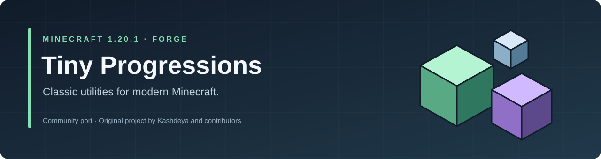
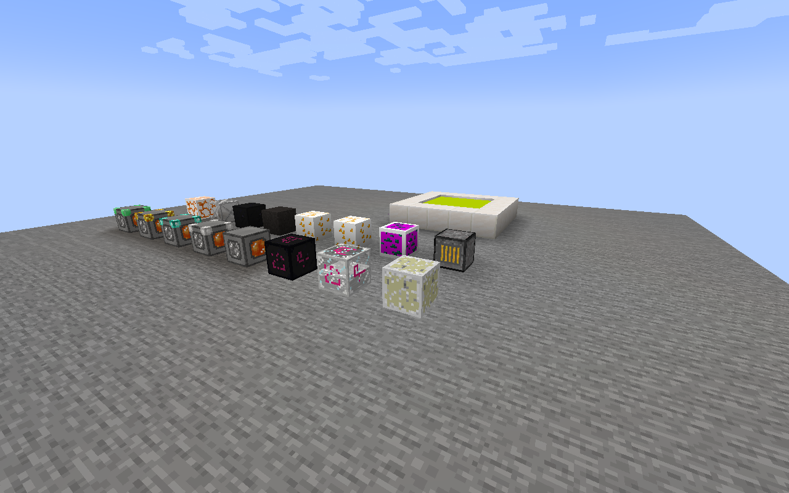
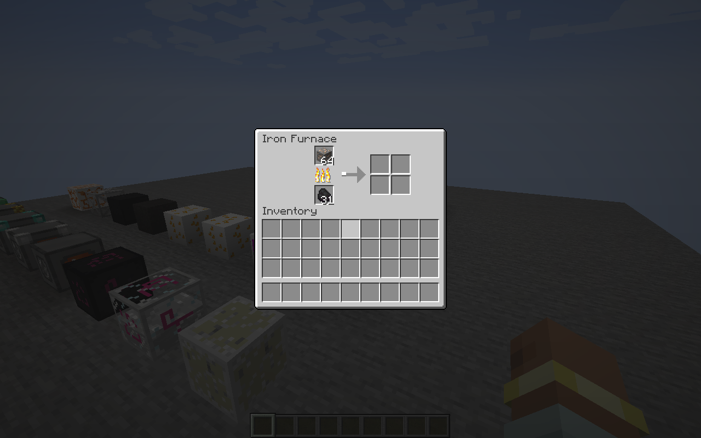
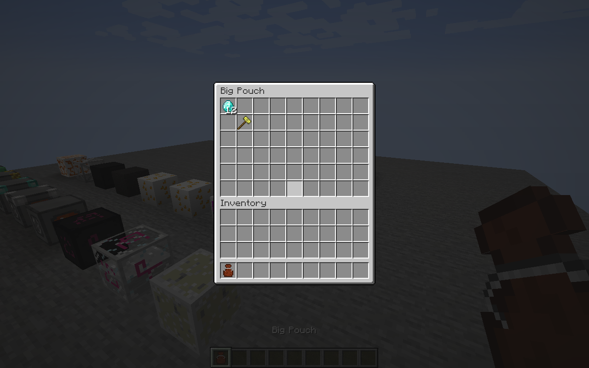
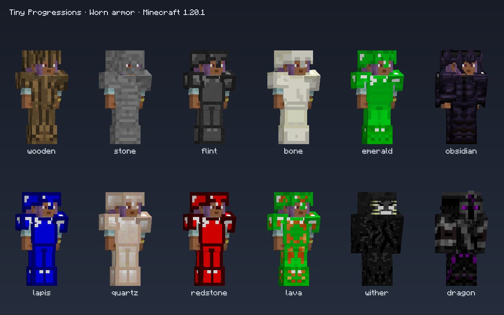

<p align="center">
  
</p>

# Tiny Progressions · Minecraft 1.20.1

**An unofficial Forge port of [Kashdeya's Tiny Progressions](https://github.com/Kashdeya/Tiny-Progressions).**

Classic progression utilities, original textures, and familiar equipment for Minecraft 1.20.1. The original project was created by **Kashdeya, Darkosto, GenDeathrow, and ArclightTW**. This repository maintains the 1.20.1 port; it does not claim authorship of the original mod or endorsement by its authors.

[Download the mod](https://github.com/veyndor1/Tiny-Progressions-1.20.1/releases/tag/v4.0.0-alpha.2) · [Installation](docs/INSTALLATION.md) · [Configuration](docs/CONFIGURATION.md) · [Report an issue](https://github.com/veyndor1/Tiny-Progressions-1.20.1/issues/new/choose)

| Component | Requirement |
| --- | --- |
| Minecraft | **1.20.1** |
| Mod loader | **Forge 47.4.10 or later in the 47 series** |
| Java | **17** |
| Mod version | **4.0.0-alpha.2** — prerelease |
| Mod ID | `tp` |
| Installation | Client and server |

## Features

| Category | Included content |
| --- | --- |
| Resource production | Tiered cobblestone generators and the Iron Furnace |
| Farming | Growth crystals, watering cans, and crop utilities |
| Equipment | Tools, weapons, material armor sets, and specialized equipment |
| Storage and convenience | Portable pouches and the infinite water bucket |
| Building and exploration | Decorative blocks, colored lighting, ores, and world generation |
| Configuration | Server settings for feature availability and gameplay values |



*Actual in-game rendering of representative blocks from this port.*

## Quick installation

1. Install Minecraft **1.20.1** with a compatible **Forge 47.x** installation.
2. Download `tp-4.0.0-alpha.2.jar` from the [release page](https://github.com/veyndor1/Tiny-Progressions-1.20.1/releases/tag/v4.0.0-alpha.2).
3. Place the file in the instance's `mods` directory. For multiplayer, install the same version on the server and every client.
4. Launch the instance with **Java 17**.

Use the player jar named above. The optional `-audit.jar` developer companion is not required for gameplay.

The release is an **alpha**. Back up worlds before changing mod versions. Existing Minecraft 1.12.2 worlds are not automatically converted. Fabric and NeoForge are outside this port's supported configuration. See [compatibility](docs/COMPATIBILITY.md).

## Screenshots

| Iron Furnace | Portable pouch |
| --- | --- |
|  |  |



*Screenshots show the mod running in Minecraft 1.20.1. Original artwork remains credited to its creators.*

## Configuration

Gameplay settings are stored at:

```text
<world>/serverconfig/tinyprogressions-server.toml
```

Server settings are synchronized to connected clients. To supply defaults for new worlds, place a template at `defaultconfigs/tinyprogressions-server.toml`. See the [configuration guide](docs/CONFIGURATION.md) for examples and restart guidance.

## Build from source

A **Java 17 JDK** is required. The Gradle wrapper downloads the build dependencies.

```shell
git clone https://github.com/veyndor1/Tiny-Progressions-1.20.1.git
cd Tiny-Progressions-1.20.1
./gradlew build
```

On Windows, use `.\build.ps1 build` or `.\gradlew.bat build`.

The player jar is produced at `build/libs/tp-4.0.0-alpha.2.jar`. The original 1.12.2 source tree and Python conversion tools are **not required** for a normal build. See [development](docs/DEVELOPMENT.md) and [contributing](CONTRIBUTING.md).

## Project information

- [Upstream attribution and authors](CREDITS.md)
- [Rights and third-party notices](LICENSE.md)
- [Compatibility and limitations](docs/COMPATIBILITY.md)
- [Security reporting](SECURITY.md)

Please submit issues about this port to **this repository**. The upstream project remains the source of the original Tiny Progressions mod.
